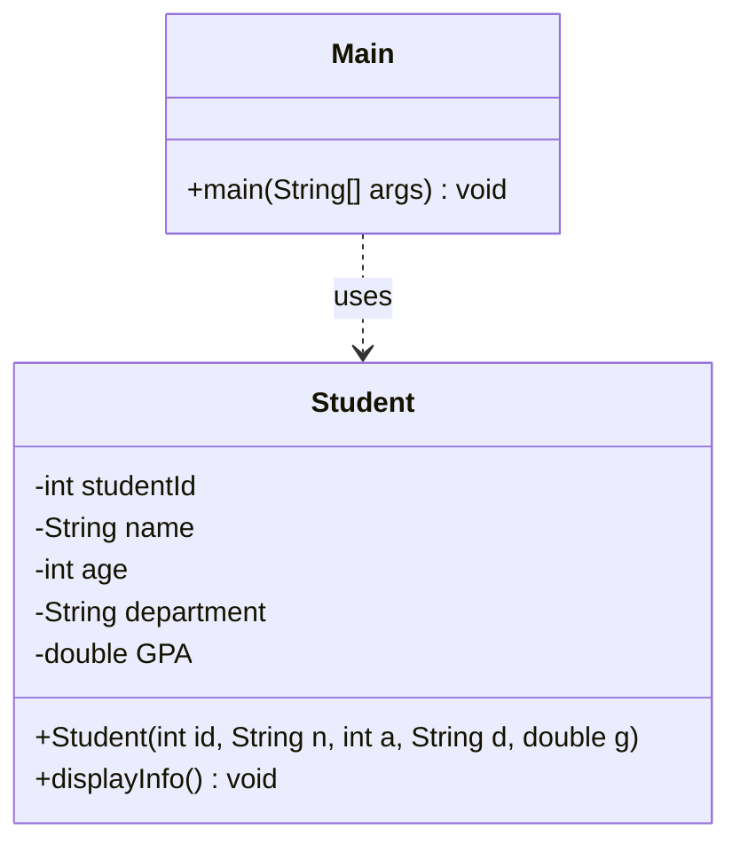

# Student-Java-
Student Management System using Java

# Student Management System

## Description
This project is a simple Student Management System developed using Java.

## Class Diagram

## Programming Language
Java
